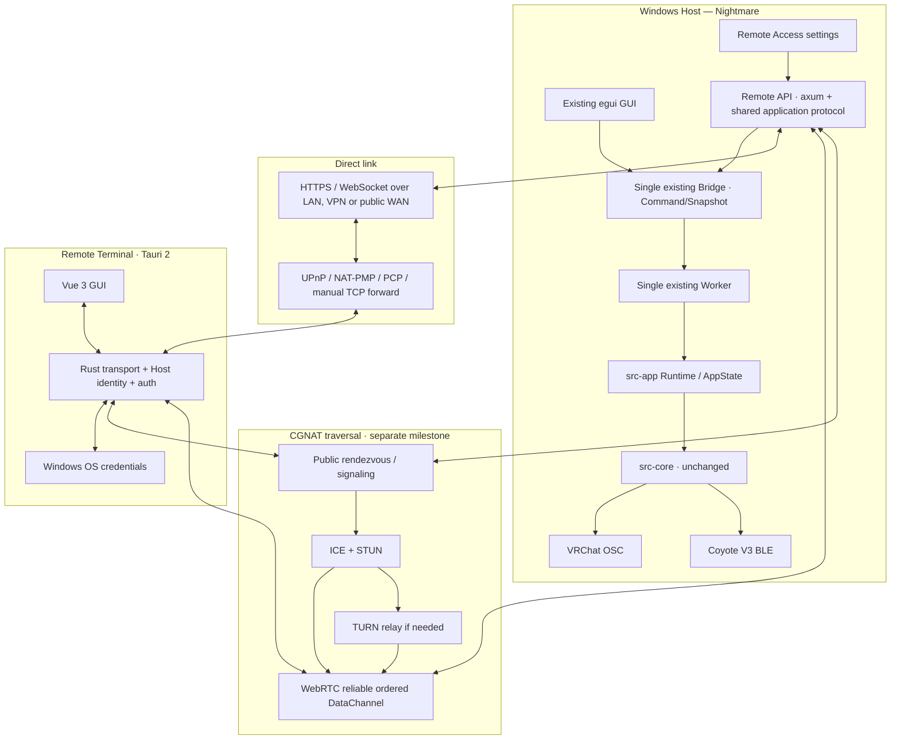

# 01. Архитектура Host / Remote Terminal

**Status: Proposed · 2026-10-15 · v0.5**

## Текущая организация исходников

| Уровень | Текущий исходник | Роль |
|---|---|---|
| GUI | `src-gui/src/app.rs`, `views/*` | eframe/egui, действия пользователя, рендер |
| Command bridge | `src-gui/src/bridge.rs` | `Command`, `Snapshot`, `Shared`, `Worker`, mpsc |
| App runtime | `src-app/src/runtime.rs`, `app_state.rs` | Запуск сессии, BLE coordinator, устройства |
| Engine | `src-core/src/cli/engine.rs` | Изменение конфигурации, обработка зон, output |
| Transport to hardware | `src-core/src/ble/*`, `osc/*` | BLE Coyote V3, VRChat OSC/OSCQuery |

Upstream references:

- https://github.com/nullshii/ShockingVRC/blob/egui/src-gui/src/bridge.rs
- https://github.com/nullshii/ShockingVRC/blob/egui/src-gui/src/main.rs
- https://github.com/nullshii/ShockingVRC/blob/egui/src-app/src/runtime.rs

`Bridge::spawn(...)` вызывается в `src-gui/src/main.rs` при создании GUI. `Worker` уже имеет полный набор локальных команд, а `Shared::snapshot()` отдаёт нужное состояние. **Сетевой слой следует подключить к этому же экземпляру Bridge**, а не дублировать worker, конфигурацию или BLE-сессии.

## Предлагаемая схема

Взаимодействие с устройством всегда через **один** Bridge. ICE/TURN не создаёт второй Worker и не добавляет отдельный способ кодировать команды. Успешное открытие UPnP mapping не эквивалентно достижимости WAN.

## Проектные единицы

**Host Runtime:** существующая `src-app` + `src-core`. Нового service/sidecar-процесса в v1 не требуется: сервер живёт внутри процесса GUI и в его Tokio runtime.

**Host Remote API:** новый модуль/crate `src-remote/` (название рабочее): HTTP server, authentication, WebSocket + будущий DataChannel transport, DTO, network discovery and port mapper. Определяет backend trait; `src-gui` реализует adapter к **существующему** `Bridge`. Сам remote crate **не импортирует `src-gui`**, иначе dependency cycle; не содержит `CliEngine`.

**Host Preferences:** настройки включённого remote-сервиса, имени пользователя, хеша пароля, TCP-порта, UPnP и серверной TLS-идентичности хранятся отдельно от `cli_config.json` и отдельно от настроек waveform.

**Host GUI:** панель `Remote Access` в `Setup` или отдельный раздел (UX-деталь не влияет на API). Показывает enabled/listening, адреса, внешний mapping, подключённых клиентов, fingerprint TLS, ошибки.

**Remote Terminal:** отдельный Tauri 2 application. Vue отображает состояние, а Rust backend обрабатывает HTTPS/WSS, позднее ICE/WebRTC DataChannel, Host identity, учётные данные и reconnect. Адрес Host вводится как IP либо DNS/DDNS hostname; обновление DDNS-записи не требует изменений в Host API. Отдельный BLE/OSC код в Remote Terminal не включается.

## Жизненный цикл Host

1. Запуск существующего `start_session()`, как сегодня.
2. Создание `GuiApp` и `Bridge::spawn()` как сегодня.
3. Чтение `remote_access.json`; при `enabled=true` — запуск remote listener, независимо от видимости окна.
4. После запуска listener — попытка UPnP mapping, если включена. Сбой UPnP не останавливает локальный GUI или сервер.
5. Отключение Remote Access — закрытие listener и remote sessions, удаление только собственного port mapping.
6. Полное закрытие Host — завершение remote listener, затем существующий `shutdown_session()`.

В v1 **нет** headless Windows Service. Если `egui` закрыт, Host не работает; если минимизирован — Host продолжает работать.

## Обмен данными

**Чтение:** любой транспортный адаптер читает `Bridge::snapshot()` и передаёт на клиент, не вмешиваясь в loop ядра. `Snapshot` сейчас пересобирается `Worker` каждые 50 мс; outbound WebSocket должен передавать не чаще выбранного UI-rate (предварительно 5–10 сообщений/с) либо при нужном изменении. Это **не изменение** текущего цикла Bridge.

**Запись:** общий transport-neutral Remote API валидирует JSON-формат, преобразует его в соответствующий уже существующий `bridge::Command` и вызывает `Bridge::send()`. Локальный egui продолжает отправлять команды точно так же. Сетевой API не вызывает `CliEngine` напрямую.

**Семантика применения:** `Bridge::send()` сейчас сообщает лишь о постановке команды в очередь и не возвращает `Result` её выполнения. Поэтому v1 `command.accepted` означает **команда поставлена в очередь**, а не применена. Реальное изменение подтверждается следующим `snapshot`. Не выдавать ложный `applied=true`.
**Host arbitration & Remote Power Authority:** ровно одна авторизованная удалённая управляющая сессия на Host через WSS или RTC; локальный egui не занимает слот. Все mutations поступают в один Host Worker; UI показывают один фактический state, включая значение выше Host-only remote cap. Remote Power Limits cap (Option A, independent A/B values, ADR-021) проверяется на Host только при удалённых `SetLimitMin`/`SetLimitMax` по cap соответствующего канала до dispatch **и только если Host локально включил `Remote Maximum Strength`**. Default OFF принят: обе стороны используют обычный диапазон `0..200` без дополнительного ограничения. Зоны/Intensity/Modulation/Presets/Alarm не получают новую проверку cap. Это не предел фактического hardware output. Подробности: [`11-remote-session-and-strength-cap.md`](11-remote-session-and-strength-cap.md).

**Несколько устройств:** текущий `Worker` хранит единый `active_device: usize`. В v1 он остаётся общим для egui и Remote Terminal: переключение устройства одним клиентом переключает активное устройство в другом. Это ограничение фиксируем явно; адресная маршрутизация по MAC — отдельное возможное улучшение, не часть MVP.

## NAT traversal без параллельного API

После прямого WSS добавляем ICE/STUN/TURN + публично достижимый **собственный или явно выбранный пользователем** rendezvous/signaling. Это **второй transport adapter для тех же messages, Backend/Bridge и auth policy**, а не отдельный Remote API. WebRTC DataChannel carries application JSON frames; HTTP REST не переносится по нему как TCP. Signaling/TURN не получают пароли или команды и не исполняют ничего на Coyote. **Никаких предустановленных публичных сервисов** в приложении; наш московский OpenShock-host — только частная точка развёртывания отдельных сервисов ShockingVRC. Детали: [`07-ice-turn-signaling.md`](07-ice-turn-signaling.md) и [`10-self-hosted-connectivity.md`](10-self-hosted-connectivity.md).

## Точки расширения без изменения алгоритмов

- Новый crate для remote transport и auth.
- Минимальные изменения `src-gui/src/main.rs` / UI setup и в точке подключения `Bridge` к серверу.
- При необходимости — узкая публичная оболочка вокруг `Bridge` (не менять его очередь, `Worker::apply`, `src-core`).
- Новый Tauri workspace/app для отдельного Remote Terminal, после успешного API.

## Независимость транспорта от адресации

- HTTPS/WSS и версия API одинаковы для LAN, VPN, публичного IP и DDNS-имени.
- В v1 поддерживается pinned server identity; DNS/DDNS — только способ найти Host. Перемена IP не сбрасывает проверенный pin.
- Автоматический DDNS updater, получение сертификата от публичного CA через ACME и NAT traversal с STUN/ICE/TURN — будущие сетевые функции, а не изменение Engine/Bridge.
- STUN сам по себе не создаёт inbound TCP mapping для HTTPS/WSS. Текущий WAN transport остаётся TCP через UPnP/NAT-PMP/PCP или ручной port forwarding.

## Нагрузочная изоляция GUI

- `src-gui/src/app.rs:307–309` вызывает `request_repaint_after(16ms)` при активном фоне.
- `src-gui/src/bridge.rs:332–347` вызывает repaint callback при публикации snapshot каждые 50ms.
- GUI FPS limiter должен **контролировать оба источника repaint**, а не только `request_repaint_after`.
- Целевые лимиты: focused 30 FPS, unfocused 5 FPS, minimized rendering suspended. При восстановлении — немедленный repaint.
- Работа `Worker`, устройств, API и фонового обмена должна оставаться прежней.
