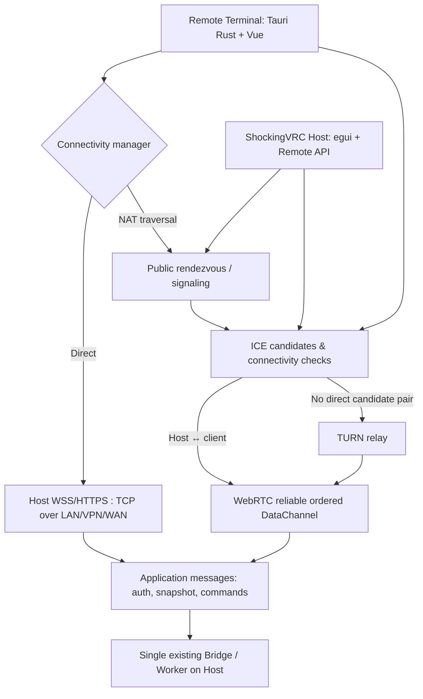

# 07. NAT traversal transport: STUN / ICE / TURN / rendezvous

**Status v0.15: ICE/TURN + BYO infrastructure accepted; ordered/reliable DataChannel and shared JSON API approved ADR-028. Host identity binding conditional ADR-033, implementation and deployment pending.**

## Почему второе подключение нужно

`UPnP/NAT-PMP/PCP + TCP HTTPS/WSS` решают обычную домашнюю сеть с доступным входящим WAN IP. DDNS решает только изменение адреса. При CGNAT/сложных NAT прямой TCP listener может быть недоступен. STUN определяет внешние bindings и используется ICE для проверки кандидатов; сам по себе *не* открывает входящий TCP порт. TURN даёт relay-трафик, когда P2P-путь не устанавливается.

## Сеть и единый application protocol

- **Direct adapter:** HTTPS REST + WSS JSON frames (existing agreed design).
- **Traversal adapter (approved design):** WebRTC DataChannel (`DTLS/SCTP`) using ICE/STUN, TURN as fallback. Reliable+ordered mode; carries the **same JSON envelope** `hello`, `auth.login`, `snapshot`, `command` etc. REST calls have RPC message analogues. UI and `BridgeRemoteBackend` do not know which adapter is active.
- **Signaling/rendezvous:** discover Host by a stable `server_id` / pairing code; exchange SDP/ICE candidates and negotiate DTLS identity. Must be reachable by both endpoints via outbound connections; runs separately from users' home networks.
- **TURN:** publicly reachable relay with ephemeral credentials; requires deployable service (e.g. coturn) and public connectivity. Prefer UDP TURN; consider TCP/TLS TURN on restricted networks after tests. TURN relay **is not** the same as a reverse HTTPS proxy and does not consume/apply device commands itself.

## Поток соединения

1. Terminal выбирает сохранённый профиль; Connectivity manager пробует разрешённый Direct endpoint (LAN, VPN или DNS/IP WAN).
2. Если direct unavailable, и `rendezvous` настроен, обе стороны устанавливают **исходящее** соединение с signaling service.
3. Клиент и Host обмениваются ICE candidates/offer/answer; ICE проверяет host/srflx/relay candidates, TURN используется по необходимости. Время перебора, повторение и приоритеты — policy уровня транспорта, не Worker.
4. **До отправки пароля** клиент проверяет криптографическую привязку negotiated remote DTLS endpoint к доверенной Host identity; одного ID комнаты, результата signaling и TLS до signaling недостаточно. Host доказывает владение долговременным private identity key подписью согласованных ephemeral DTLS fingerprints/session nonce/offer-answer transcript. Точный signature algorithm и формат — отдельная implementation ADR (предлагается Ed25519).
5. DataChannel открыт → `hello` → `auth.login` → `snapshot`/`capabilities` → обычные `command` frames. При смене transport канонические команды не меняются.
6. Если ICE failed и TURN unavailable, UI показывает диагностический код и предлагает direct WAN/VPN/manual forwarding вместо ложного «подключено».

## Важная связь с ранее принятым TLS pinning

Сейчас принят TLS certificate/SPKI pin для WSS. Это **не** проверка DTLS peer автоматически: WebRTC DataChannel использует отдельный handshake. Чтобы избежать двух непонятных владельцу fingerprint, вводим **стабильную Host identity**, которая связывает оба транспорта. Первоначальная верификация Host через отображённый на локальном Host fingerprint/QR. Для Direct удостоверяем TLS endpoint; для ICE удостоверяем signed binding согласованного DTLS key к **той же доверенной Host identity**. Целевое связывание long-term Ed25519 identity и negotiated DTLS fingerprint **утверждено условно** (ADR-033): проверить возможности библиотек и конкретную криптографическую транскрипцию, прежде чем применять для учётных данных.

Signaling/TURN считаются недоверенными к содержимому сообщений: TLS защищает signaling transport, WebRTC DTLS защищает канал Host↔Terminal, а Host identity verification защищает от подмены конечной стороны. **Логин/пароль не отправляются в signaling или TURN credentials**. Оператор может пользоваться теми же серверными username/password, что и в Direct.

## Инфраструктура и эксплуатационные последствия

**Принято:** BYO signaling/STUN/TURN, полностью self-hostable; **все поля настройки публичных сервисов пусты по умолчанию**. Нет зашитых публичных STUN, TURN, signaling URL, токенов или аккаунтов; каждый пользователь указывает свои сервисы. В документации — развёртывание своего rendezvous + coturn, поддержка сторонних совместимых сервисов при явном указании.

Для CGNAT без VPN/проброса необходим доступный извне сервис rendezvous и, при невозможности ICE P2P, публично достижимый TURN relay. **Без явно настроенной инфраструктуры нельзя обещать CGNAT-connectivity.** Прямой WSS не использует эти узлы. Наш частный пример — co-location сервисов на московской машине, где работает OpenShock; компоненты раздельны, OpenShock не используется в качестве signaling API по умолчанию, и наш узел не входит в дистрибутив как endpoint.

Предлагаемые configuration areas:

| Host | Terminal | Infrastructure |
|---|---|---|
| `remote_enabled`, `identity`, `allow_traversal`, `rendezvous_url = null`, `stun_urls = []`, `turn_servers = []` | Direct endpoint, свой `rendezvous_url = null`, отдельный Host profile ID | HTTPS/WSS rendezvous service (пользовательский, без общего default) |
| Host credentials, TCP listener, UPnP options | trusted Host identity pin, TURN credentials scoped to chosen service | TURN service UDP, optionally TCP/TLS (пользовательский) |
| connectivity telemetry | selected transport and connectivity errors | TTL-scoped TURN creds, discovery and signaling timeouts |

Rendezvous URL должен совпадать по назначению у Host и Remote Terminal; оба должны однозначно выбирать одну доверенную self-hosted instance, но пользователь может хранить несколько профилей. STUN без собственного сервера не запустится автоматически (empty default), однако ICE host candidates в LAN могут работать и без STUN — при наличии signaling. Для TURN предпочтительно, чтобы ephemeral credentials выдавал собственный rendezvous из секретов, хранящихся только на сервере; ни один shared secret нельзя вшивать в клиенты.

Нет обязательной привязки к конкретному VPS/провайдеру. Прямой LAN/WAN продолжает работать **без** rendezvous/TURN. Сбои TURN не останавливают локальное приложение и Direct API. Полный deployment checklist — [`10-self-hosted-connectivity.md`](10-self-hosted-connectivity.md).

## Контракт ошибок и наблюдения

`connection_path`: `direct_wss|ice_host|ice_srflx|turn_relay` (тип выбранного пути диагностический; ICE final actual pair). `nat_status`: detected / probable / unknown, **не** «STUN открыл порт». События `signaling_unreachable`, `ice_timeout`, `turn_auth_failed`, `identity_mismatch`, `transport_closed` показываются Terminal и Host. Никаких токенов/секретов/сырого SDP с чувствительными данными в обычные журналы без явно включенной отладки.

## Что не делать

- Не пытаться просто передать HTTPS TCP через STUN.
- Не использовать обычный `UPnP` как замену ICE/TURN при CGNAT.
- Не запускать второй CliEngine/BLE/OSC на relay, signaling или клиенте.
- Не размещать пользовательский пароль в signaling-запросе или TURN username.
- Не считать hostname/DDNS, room code или STUN result доказательством подлинности Host.

## Критерии испытаний

- P2P host candidate (одна LAN); server-reflexive candidate (разные NAT при доступности); принудительный TURN-relay fallback (CGNAT-подобная изоляция).
- Host identity mismatch → **отказ от входа** до передачи учётных данных.
- Изменение DDNS IP не меняет привязанную identity, если сервер тот же.
- Потеря signaling после установления datachannel не должна сама по себе прерывать уже рабочий transport, если библиотека это допускает; потеря TURN relay ожидаемо разрывает relay-путь.
- После переподключения отправляем новый полный Snapshot, команды без ACK не воспроизводим автоматически.
- Проверить недостаточность NAT hairpin, отказ STUN, отказ TURN UDP, fallback TURN TCP/TLS отдельно.

## RFC/базовая техническая справка

- STUN: RFC 8489 https://www.rfc-editor.org/rfc/rfc8489
- ICE: RFC 8445 https://www.rfc-editor.org/rfc/rfc8445
- TURN: RFC 8656 https://www.rfc-editor.org/rfc/rfc8656
- WebRTC data channel: RFC 8831 https://www.rfc-editor.org/rfc/rfc8831
- SDP data channel negotiation: RFC 8841 https://www.rfc-editor.org/rfc/rfc8841

**Этот документ — архитектурный проект, не заявление, что WebRTC/ICE/TURN уже реализованы.**
