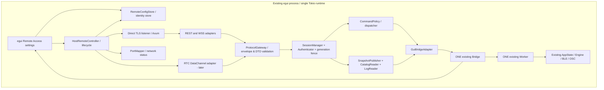

# 20. Host Remote Server — detailed architecture

**Status:** PROPOSED FOR REVIEW · v0.16 · 2026-10-15  
**Basis:** APPROVED Remote API v1, v0.15 (`14-*`, `15-*`, schemas and ADR-001–038).  
**Target:** `Zaknin/ShockingVRC-Term`, `feature/remote-access` based on `e076bc2ede4726a976c60613031f48c0bc31e0b9`.  
**Scope of this document:** internal Windows **Host** design only. No source changes have been made. All proposals marked `HOST-P*` await approval. Nothing below overrides approved wire protocols.

## 1. Objective and non-negotiable invariants

An existing Windows `egui` application hosts the authoritative `Bridge`, `Worker`, `AppState`, BLE and OSC. The new server accepts **at most one authenticated remote operator** via direct TLS/WSS (eventually WebRTC DataChannel), exposes the already approved Remote API, and relays whitelisted operations through the **same** `Bridge` used by the local GUI.

- Do not change `src-core`, BLE, OSC, alarm calculations, waveform, DSP, modulation algorithms, output rules, command queue semantics or 50-ms Worker cycle. Do not rewrite the existing local GUI to Tauri.
- Do not add a second Worker, another runtime controlling devices, a headless Windows service, or a new independent source of configuration truth.
- When remote access is OFF (default), do not open listener, launch rendezvous connection, discover a public address, or create NAT mappings.
- Disconnect/revoke/network failure affects **only remote control**. It never silently powers down channels, unloads presets, resets alarm, or disconnects the Coyote device.
- Preserve approved Remote API v1: 37 allowed command operations, full direct REST companion, WSS interactive protocol, ordered/reliable RTC later, one slot, heartbeat 5s, loss detection ~15s, reservation 30s, bearer TTL 900s, idempotent resume/replay, 5–10Hz snapshots, max 10Hz, frame cap 256KiB, 30 commands/s, default TCP 4318.
- Host-only master remote-cap switch defaults OFF. Independent cap A/B values. When ON, check **only remote `channels.set_limit_min/max`**; never filter displayed actual values and never modify Alarm/Presets/other remote operations.
- No shipped STUN, TURN, rendezvous servers or providers. Moscow/OpenShock hosting is private operational choice, not a bundled service or default URL.
- ADR-033 cryptographic binding is **conditionally accepted** and a hard technical gate. Do not transmit credentials or permit remote mutations until strict identity verification is implemented and tested. No trust-all TLS/TOFU fallback.

## 2. Actual upstream boundaries (confirmed at e076bc2)

| Existing source | Confirmed role | Design implication |
|---|---|---|
| `src-gui/src/main.rs` | Builds Tokio runtime; starts `runtime::start_session`; initializes `Bridge::spawn` inside `eframe::run_native` app creator; calls `shutdown_session` on exit | Server lifetime belongs to same process and Tokio runtime; attach after Bridge creation, stop before session/runtime shutdown |
| `src-gui/src/bridge.rs` | `Bridge { tx: UnboundedSender<Command>, shared: Arc<Shared> }`; `Bridge::send(cmd)` returns `()`; `Bridge::snapshot()` clones snapshot | Thin `try_send`/enqueue-result addition permitted; do not create a second queue |
| `src-gui/src/bridge.rs` | `Worker::run` handles commands, publishes snapshots and triggers repaint; ticker 50 ms | Remote outbound sampling is separate and does not touch ticker or GUI repaint |
| `src-gui/src/bridge.rs` | Shared snapshots/presets/zone_presets/update/toast; mutable worker-wide `active_device: usize` | Host adapter exports typed DTOs and catalogs. One shared selected device; remote cannot assume independent selection |
| `src-app/src/app_state.rs` | Runtime devices listed as `DeviceSlotInfo { mac,name,battery,connected,reconnecting }` | Expose authorized status DTO, not runtime structs |
| `src-app/src/logger.rs` | Process-wide `LogBuffer=Arc<Mutex<VecDeque<String>>>`, capacity 2000 | Add bounded sanitized pagination and optional streaming without modifying logger core |
| `src-core/src/cli/engine.rs` | `CliStatus`/`ChannelStatus` are not `Serialize`; engine and BLE state remain private | Explicit network DTOs; no JSON serialization of internal engine objects |
| `src-core/src/osc/types.rs` | `ZoneEvent` not `Serialize` | Explicit `AvatarZoneDto` |
| `src-core/src/cli/alarm.rs` | `AlarmStatus` not `Serialize` | Explicit `AlarmStatusDto`; existing alarm semantics untouched |

`Bridge::send` is fire-and-forget. An ACK sent merely because a frame parsed is incorrect. A new additive enqueue-result helper may return the actual `UnboundedSender::send` result while preserving original `send()` for egui. A subsequent snapshot is evidence of the reported state, not a hardware/application ACK. No fake `applied` event.

## 3. Component graph and ownership



**Crate split:** new `src-remote/` crate contains networking, auth, protocol wire model, SessionManager, TLS, mapper and backend **traits**. It MUST NOT import `shocking_vrc_gui`. `src-gui` depends on `src-remote` and implements `GuiBridgeAdapter` using existing `Bridge` and `Shared`. This prevents `src-remote <-> src-gui` circular dependencies. Shared stable wire types live in `src-remote::protocol` (or an explicitly justified tiny shared crate, but not in `src-core`). Future Tauri client can share the protocol schema and generated DTO contract, not import Host Engine code.

**Ownership:** exactly one `HostRemoteController` instance per Host application, one session manager shared among REST/WSS/RTC, one config store, one identity, one outbound publisher. No transport can allocate its own remote-operator pool or skip common command policy.

## 4. Proposed Rust modules and responsibilities (HOST-P01)

```text
src-remote/
  Cargo.toml
  src/
    lib.rs                    # public API and RemoteBackend trait
    protocol/
      mod.rs                  # v1 envelopes, strict serde + wire DTOs
      validation.rs           # UUID, enum, size/depth, duplicate-key guards
      errors.rs               # typed protocol/HTTP errors
      schema.rs               # protocol version and capability gates
    service/
      controller.rs           # start/stop/reconfigure; lifecycle state machine
      status.rs               # diagnostic status for Host UI
      supervision.rs          # JoinHandles, CancellationToken, restart/errors
    auth/
      credentials.rs          # password verification, Argon2id, rate limits
      sessions.rs             # single operator slot, auth/resume/heartbeat
      generation.rs           # atomic fencing for superseded transports
      replay.rs               # 15s resume and 120s command-dedup caches
    api/
      http.rs                 # Axum router, REST auth, no-store, body bounds
      websocket.rs            # WSS frames / backpressure / liveness
      gateway.rs              # same JSON command/event protocol for transports
      dispatch.rs             # authorization + Host-only cap + Bridge call
    publish/
      snapshot.rs             # full DTO snapshots, <=10Hz coalescing
      catalogs.rs             # preset/zone-preset listing and change notices
      logs.rs                 # sanitized bounded logs, cursor/pagination
    connectivity/
      direct.rs               # listener binding, address reports
      tls.rs                  # pinned server cert/identity server side
      port_mapping.rs         # UPnP/NAT-PMP/PCP / own mapping lease
      rtc.rs                  # adapter added at ICE/TURN milestone
      rendezvous.rs           # outbound BYO signaling, never on by default
    persistence/
      settings.rs             # atomic remote_access config, validation
      host_identity.rs        # protected long-term Host private key
```

Names are illustrative implementation boundaries, not mandated filenames. Prefer **a handful of simple files** over gratuitous abstraction; separation of trust, policy and application Engine remains mandatory. `SessionManager` is in-memory and single shared object; `Backend` interface is minimal and capability-scoped.

## 5. Remote backend adapter contract (HOST-P02)

The remote crate needs **read and enqueue**, not `AppState` or hardware APIs. Suggested internal interface:

```rust
// PSEUDOCODE: architecture sketch, NOT compiled code.
trait RemoteBackend: Send + Sync + 'static {
    fn snapshot(&self) -> Result<RemoteSnapshotDto, BackendError>;
    fn catalogs(&self) -> Result<RemoteCatalogDto, BackendError>;
    fn logs(&self, cursor: Option<u64>, limit: u16)
        -> Result<RemoteLogsPageDto, BackendError>;
    fn enqueue(&self, command: RemoteAllowedCommand)
        -> Result<(), BackendError>; // proven send-to-existing-Bridge only
}
```

The adapter in `src-gui` performs:

1. Convert `Bridge::snapshot()` and read-only `Shared` catalog state into **explicit network DTOs** (`15-data-model-and-operation-types.md`); never dump `Shared`/`CliEngine`/`UpdateState`.
2. Map each of 37 vetted wire operations to an **existing** `bridge::Command`, with no unrestricted `Command` deserialization.
3. Use an additive `Bridge::try_send(...) -> Result<(), SendError<Command>>` (or equivalent) so `command.accepted.queued=true` is defensible. Existing `Bridge::send()` and queue/Worker remain intact.
4. Apply operations to whichever `active_device` the existing Worker owns; the network gateway must surface selection changes. Do not fake per-client device context.
5. Preserve no-op semantics of existing Worker when device/preset is unavailable; never report an apply ACK if Worker silently ignores a command.

**Concurrency note:** Host UI and remote use the same mpsc channel and last Worker-processed mutation wins. `Snapshot.revision` increases every 50ms and is NOT a config version/CAS. A remote request with a zone index or preset index can become stale if local UI changes state; the gateway may validate a *snapshot-relative expected selector* but cannot promise atomic apply with unchanged Worker (ADR-038). Never silently claim serializable transactions.

## 6. Protocol gateway and request pipeline (HOST-P03)

A single pipeline is used by WSS, REST `/commands` and eventually RTC:

```text
Transport ingress
  -> frame/body, UTF-8, time, size, nesting and duplicate-key limits
  -> strict v1 envelope + type/op/arg decoder
  -> authenticated session / valid bearer OR transport generation
  -> ACTIVE session + generation fencing + request-id dedup
  -> Host-remote-only command allowlist (37)
  -> Host-only remote-cap validation if op=min/max and enabled
  -> latest-target sanity check + rate limit
  -> enqueue to existing Bridge
  -> command.accepted {queued:true} (or typed rejection)
  -> independent SnapshotPublisher publishes authoritative new state
```

**No alternate routes.** Direct REST command invocation MUST follow exactly the same policy as WSS and RTC. Cap config/mappings/password/pairing/updater remain **Host-local controls**, never remote writable.

**Order-of-operations and races:** The session/generation validity check and enqueue acceptance require a small atomic admission critical section (or an equivalent single actor), to guarantee `Host kick`, session revoke and generation replacement prevent **new enqueue after the fencing point**. Do not hold a lock across `await` or over HTTP response sends. Enqueue already admitted before kick may still be applied later. Password verification and TLS negotiation must not hold this critical section. No promises of cancelling old commands in the upstream queue.

**Remote power-cap exact behavior:** `enabled=false` → no extra policy checks; usual `PowerLimits` range 0..200 for both sides. `enabled=true` → independently compare *incoming requested values* for `channels.set_limit_min/max` with `A_cap`, `B_cap`. Reject `value > cap` as `REMOTE_LIMIT_EXCEEDED`, including `current_actual`, `cap`, and channel in safe authorized error details. Local updates above cap must be visible unaltered. Reject a remote `set_limit_max` request if the currently observed minimum is higher than the requested max and upstream `PowerLimits::new` would normalize the result above the remote cap; this is a **pre-enqueue compatibility validation** from approved v0.15. Observe that concurrent local writes and upstream index mutations mean this is not a guarantee of final actual output level; the feature is **only a remote write policy**, not hardware limiter. Never apply it to alarms, presets, zones, intensity or config.load.

**Transport-independent replay/dedup:** command dedup scoped to `(session_id, request_id)` plus payload hash, max TTL 120s; duplicate same payload -> cached ACK **only if original enqueue was actually proven**, different payload -> `DUPLICATE_REQUEST_CONFLICT`. Do not auto-retry uncertain mutating commands at client reconnect. Do not hide an uncertain outcome with `applied:true`.

## 7. Session Manager and credential handling (HOST-P04)

**Canonical states:** `FREE` → `PENDING_ATTACH` (REST login, 15s), or `ACTIVE` (WSS/RTC login); `ACTIVE` → `RESERVED` after ~15s lost heartbeat, `RESERVED` → `ACTIVE` on valid resume within 30s, else → `FREE`; any state → `FREE` on Logout, Host kick, password change, Host Remote OFF or process restart. On Host restart, a new `server_epoch` invalidates previous volatile tokens/tickets. `ACTIVE` can be resumed while old transport is half-open, with **monotonically incremented generation** and old generation fenced atomically.

Credentials and session secrets:

- Host GUI sets username/password; persist Argon2id password verifier with random salt, **never plaintext password**. Add slow guessing controls and uniform login failures without leaking account existence.
- One long-lived Ed25519 Host identity protected at rest by Windows user-specific mechanism. This identity is not an HTTP bearer/session secret and survives restart; see ADR-033 gate.
- Memory-only CSPRNG `resume_ticket` (>=256-bit) and independent opaque `access_token` (256-bit), with token TTL 900 s and renewal over the authenticated current transport. Prefer keyed digests of sensitive tokens at rest in in-memory lookup tables; avoid accidental formatted/debug dumps.
- WSS login uses in-band `auth.login` **after** identity verification; REST login shares single SessionManager, reserves `PENDING_ATTACH` for 15s, attaches via WSS Bearer or authenticated REST heartbeat. Never put secrets in query params, URLs, Vue, logs or crash diagnostics.
- WSS/RTC heartbeat 5s, detect silence in ~15s, reserve for 30s **from detection**. Distinguish explicit logout/Host kick (immediate) from transient link failure (reservation). Use monotonic clock for timeout comparison.
- `auth.resume` must accept only same valid session ID/ticket and bound Host identity; move generation once, issue next ticket/access token and authoritative full snapshot. Replay of *identical* `(server_epoch, session_id, request_id, old_ticket proof)` for 15s returns same cached new ticket/generation; at most 8 cached entries/session. Expiry/revoke flushes replay cache. Retry 1s/2s/4s, max 3 on the Terminal side.
- Host kick is immediate and does **not** auto-ban the user. Terminal receives best-effort `session.revoked`, deletes volatile secrets and stops auto-login until explicit manual Connect. If password is still valid, a subsequent manual login is allowed.

**Status privacy:** anonymous `/health` discloses only minimal protocol status. Only an authenticated session gets real snapshots/logs/devices. `SESSION_BUSY` should not disclose nickname, IP, password validity or any other user's identity. Avoid auth timing differences where possible; define behavior of correct/wrong password during occupied slot consistently.

## 8. Snapshot, catalogs and logs (HOST-P05)

**Read source of truth:** the existing `Bridge` snapshots. The gateway does NOT poll BLE/OSC itself and does not run a second signal engine. Outbound `SnapshotPublisher` clones a state under a brief read lock and serializes *outside* the lock; no locks across network send. Periodic cadence target ~100–200ms under activity (5–10 Hz, hard maximum 10 Hz). An initial full snapshot follows successful login/resume/`state.get` irrespective of periodic cadence.

**Do not confuse snapshot revision and command application.** Each push includes its own `(server_epoch, stream seq)`; on transport replacement or reconnect client drops stale streams and receives full resync. If unchanged, publisher may skip identical payloads, while heartbeat maintains liveness. Keep bounded per-client outbound queue (only 1 remote session) and **coalesce snapshot pushes**: drop superseded snapshots rather than accumulate unlimited frames during stalled WAN. Do not drop command responses, revoke notices or current full resync; define queue priorities. If a full snapshot exceeds 256KiB, send a typed `SNAPSHOT_TOO_LARGE` or pagination strategy as a separately versioned protocol change; do not truncate unseen state silently.

**DTO conversion:** `CliConfig` and `AlarmConfig` already expose serde-compatible data but wire enums and shape are defined by `schemas/remote-models-v1.schema.json`, **not** incidental Rust derives. `CliStatus`, `ChannelStatus`, `AlarmStatus`, `ZoneEvent`, `DeviceSlotInfo`, `PresetEntry` and `ZonePresetEntry` need explicit conversion; avoid hidden `Debug` textual blobs. GUI `Shared.update`, `Toast`, pending update executable path, local filesystem paths and identity private key never leave the Host.

**Catalogs:** index-based upstream operations require sorted/stable ordering *within each exported catalog snapshot*, and a `catalog_revision`/hash/change signal for clients. An independent refresh could reorder indices; the full contract does not guarantee atomic referential stability against local changes. If catalog entry no longer exists at dispatch, return error where determinable; otherwise Worker may no-op. `catalogs.changed` triggers re-fetch.

**Logs:** read bounded `LogBuffer`, strip known secret-bearing fields and redact credentials/session material *at ingestion and egress* wherever feasible. Paginate via opaque cursor and `limit=1..200`; if ring overflows signal gap. Never include Bearer header, private key, resume_ticket, signed secret transcript, passwords, TURN admin credentials or raw HTTP auth payload. `logs.append` uses only approved categories and authorization.

## 9. Host Remote Access UI / ownership (HOST-P06)

One locally editable pane in existing `egui` (recommended inside `Setup` or adjacent `Remote Access` tab):

| Control | Who can change it | Expected behavior |
|---|---|---|
| Master Remote Access ON/OFF | Local Host only | Default OFF; OFF closes network endpoints and revokes sessions |
| Username / set-or-change password | Local Host only | Argon2id verifier; password change forces re-login |
| Bind/interface and TCP port | Local Host only | Default 4318; reject invalid bind/port, report error without crashing GUI |
| TLS Host fingerprint and pairing | Local Host only | Show stable fingerprint and copy/QR; never expose private key |
| UPnP / NAT-PMP / PCP / manual external mapping | Local Host only | Each auto-map is opt-in; report lease/failure; manual instructions on failure |
| Remote Maximum Strength master + A/B | Local Host only | OFF default, 0..200 each; remote cannot edit setting |
| Current remote session state / transport / last contact | Local Host only | Read-only live diagnostics; client nickname treated as untrusted label |
| `Disconnect client` | Local Host only | Immediate fencing/revoke/free slot without changing Engine |
| Signaling/STUN/TURN | Local Host only, later milestone | All defaults blank; validate URLs/credential refs, show connectivity and relay status |

Saving a setting is NOT implicitly granting remote access: entering a port or credential should not start listener until Remote Access is enabled. Changing listener-related settings while ON is a managed stop/restart of *the remote service only*; all sessions are revoked, not the BLE/OSC runtime. Changing cap A/B while ON updates policy immediately without disconnect; pending remote requests are validated at dispatch with latest Host policy.

## 10. Server listener and NAT management (HOST-P07)

**Direct API:** one TLS endpoint (port 4318 default) serves HTTPS REST and WSS upgrade. Use Axum on existing Tokio runtime, no second binary. Bind to configured local IP / all interfaces as selected by owner; TCP listener may be reachable from LAN even when port mapping fails. TLS certificate/SPKI pairing is mandatory before accepting credentials. Keep an explicit `ListenerState`: `DISABLED`, `STARTING`, `LISTENING`, `DEGRADED`, `STOPPING`, `ERROR`. Host UI shows actual listen address and distinct UPnP mapping status; do not conflate binding, NAT mapping, and true external reachability.

**UPnP/NAT-PMP/PCP:** opt-in mapping only after listener is up. Record mapping owner/protocol/internal endpoint/external port/lease identifier and renew before expiry. On Remote OFF or Host shutdown remove only our own matching mapping; do not delete a user's existing static rule or other application's mapping. Loss/renewal failure marks mapper DEGRADED but never disconnects local ShockingVRC; direct LAN and manual forwarding still possible. Report CGNAT/Double NAT as diagnostic hypotheses, not guaranteed discoveries from a single external IP query. No automatic changes to Windows Firewall silently; prompt for OS permissions or provide explicit instructions.

**DDNS:** Terminal accepts hostname and re-resolves as needed; Host does not require embedded DDNS updater in initial build. Certificates/pins survive DNS IP changes. Pairing never treats DNS address alone as proof of Host identity.

**RTC milestone:** one additional `WebRtcTransport` implementing the same protocol gateway, with outbound user-specified rendezvous signaling and ICE/STUN/TURN. It shares `SessionManager`, `CommandDispatcher` and Host identity. Signaling/TURN never gets command plaintext or BLE permissions; RTC DTLS peer is authenticated using the signed fingerprint binding from ADR-033. RTC does not emulate REST endpoints. Default endpoint arrays and signaling URL remain empty. No implicit public STUN/TURN probes.

## 11. Startup, shutdown and fault containment (HOST-P08)

```mermaid
sequenceDiagram
  participant Main as main.rs / eframe
  participant GUI as GuiApp / Remote panel
  participant RC as HostRemoteController
  participant B as Bridge / Worker
  participant S as TLS server
  participant NAT as PortMapper
  Main->>B: Bridge::spawn(session, repaint)
  Main->>GUI: GuiApp::new(..., Bridge)
  GUI->>RC: start if persisted enabled and config valid
  RC->>RC: load identity + Argon2id config; crypto gate
  RC->>S: bind/listen HTTPS/WSS
  S-->>RC: listening or error
  opt opt-in mapping
    RC->>NAT: map TCP port, record owned lease
    NAT-->>RC: mapped / degraded
  end
  GUI->>RC: change local settings or Disconnect
  RC->>RC: apply policy/revoke session as appropriate
  Main->>RC: application exit / remote OFF
  RC->>S: stop admission, fence sessions, cancel tasks
  RC->>NAT: release owned lease
  RC-->>Main: service stopped (bounded cleanup)
  Main->>Main: runtime::shutdown_session(state)
```

**Integration constraint:** In current `main.rs`, `Bridge::spawn` happens inside the `eframe::run_native` app-creator closure. HostRemoteController must therefore be initialized when that `Bridge` exists, not earlier in `start_session` and not by creating another Bridge. A small `GuiApp::new` extension or `AppHostServices` holder may own Remote controller; keep the Tokio runtime alive until remote cancellation has been awaited. UI thread never blocks on a socket, password hash, UPnP discovery, or TURN traffic. Prefer cancellation token + supervised task joins, report errors via small `watch`/status struct rather than process panic.

**Fault handling:** Wrong config, denied bind, failed certificate load, CGNAT, mapping failure or exited network task MUST NOT bring down local Worker/BLE/OSC. At most the remote service shows ERROR/DEGRADED and can be restarted explicitly. A fatal identity verification/config corruption error **fails remote closed** (listener never accepts auth), while local application remains usable. On graceful shutdown, `Remote OFF` fences new commands before closing WSS and mappings; existing queued Worker commands may still finish.

## 12. Contract details and performance budget (HOST-P09)

- Strict schema validation prior to auth operations and command dispatch; budget JSON nesting/strings, 256KiB frames, bounded concurrent unauthenticated sockets, bounded handshake time and per-peer auth throttling. No CORS wildcard. HTTP `Cache-Control: no-store`, no sensitive data in URLs.
- One remote session does **not** mean unlimited unauthenticated WSS connections; impose small ingress bounds and timeouts. Avoid expensive Argon2id verification on UI thread or under a global session mutex. Prioritize session response and remote revoke messages over optional log streaming.
- Limit accepted mutations to 30/s per remote operator; backpressure and drop/coalesce snapshots as needed; do not alter existing upstream unbounded `mpsc` queue in this milestone. Overflow/rejection should be visible, not cause unbounded memory accumulation inside the remote server.
- Keep GUI smooth: no sync disk writes or networking in `egui::update`. GUI FPS optimization remains a separate milestone (30 foreground / 5 background / 0 minimized), and does not change Engine or remote snapshot cadence.
- Preserve original 137/137 Windows tests. Add new tests for CLI-independent remote crate and `GuiBridgeAdapter` with deterministic fake backend; verify no device needed for validation and startup tests.

## 13. Implementation sequence (not authorization to code yet)

1. **Design review & crypto spike**: ADR-033 feasibility of Rust TLS Ed25519 SPKI pinning and WebRTC negotiated DTLS fingerprint verification. Record exact scheme and out-of-band pairing UX; must not weaken accepted identity goals.
2. **New crate skeleton + DTOs**: `src-remote` backend trait, strict protocol schemas, fake backend, detached bridge tests.
3. **Session/auth core**: Argon2id, server_epoch, one-slot state, token refresh, heartbeat, kick, resume/replay/generation fence.
4. **Gateway & adapter**: 37-operation whitelist, read-only DTOs, CommonDispatch, additive enqueue-result method, cap A/B validation. No upstream Worker rewrite.
5. **Direct HTTPS/WSS and REST**: one port, complete approved endpoint table; backpressure, snapshots/logs/catalogs, integration tests.
6. **Host Remote panel**: persisted settings, listener status, session controls, mapping status; default OFF.
7. **Direct network and lifecycle verification**: actual Windows Host/Terminal test environment; empty config fails closed, disabled=no listener, no effect on local BLE/OSC.
8. **Separate RTC milestone**: BYO rendezvous + ICE/STUN/TURN + verified DTLS Host binding, WSS ↔ RTC resume, CGNAT integration tests; same gateway and slot.
9. **Tauri Terminal implementation** in its own reviewed design, then end-to-end UI parity and FPS milestone.

## 14. Host architecture decisions requiring review

This document **proposes** (not yet adopts): `HOST-P01` crate split; `P02` thin backend/Bridge adapter; `P03` single serialized authorization/policy/enqueue gateway; `P04` unified single-slot in-memory session manager; `P05` coalesced publisher and DTO projection; `P06` Host GUI ownership; `P07` listener/mapper lifecycle; `P08` supervisor shutdown; `P09` resource limits/tests. These implement ADR-001–038 without altering them. See `23-host-server-review-record.md` for an approval checklist and potential implementation gates.

**Hard technical gate remains ADR-033**: the chosen cryptographic binding for Host identity must be validated before implementation of remote credentials/control; the previously approved target is not a proven implementation.
