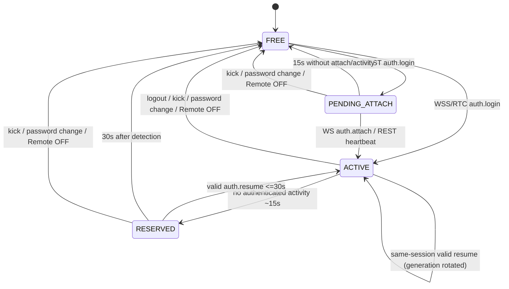

# 21. Host backend interfaces, dataflow and dispatch rules

**Status: PROPOSED (v0.16)** — implements accepted API v1. This document is not Rust code; function sketches specify responsibilities, not final type signatures.

## 1. Dependency direction

```text
shocking_vrc_core       shocking_vrc_app
        ^                     ^
        |                     |
        +------ shocking_vrc_gui -----------> shocking_vrc_remote
                        implements <--------- RemoteBackend trait
```

`shocking_vrc_remote` may depend on established Rust libraries (`tokio`, `axum`, `rustls`, `serde`, etc.) but never `shocking_vrc_gui` or `CliEngine` types. It exposes the wire DTOs from the approved schemas, a backend trait, controller and status. The GUI adapter may reference existing `Bridge`, `Shared`, `model::{Channel,ModKind}` and the core data types already used by GUI; this is **not** a core change.

Proposed `src-gui/src/remote_adapter.rs` implements the backend. Proposed `src-gui/src/remote_ui.rs` provides the locally editable `egui` settings panel. `main.rs` wires the controller to the *already-spawned* Bridge within the current `eframe` app-creator path.

## 2. API boundary and ownership table

| Information/action | Owner / sole authority | Remote projection |
|---|---|---|
| `CliConfig`, `CliStatus`, avatar zones | Existing Worker publishes `Bridge::Snapshot` | `SnapshotDto`, actual values intact |
| `active_device` | Existing Worker index, global | Current selector and corresponding device MAC |
| Preset catalogs / zone presets | Existing `Bridge.shared` catalogs | DTO in current exact index order |
| Local UI prefs | Existing `src-gui` prefs | Authorized read-only status; operations via existing commands |
| Buffered logs | Existing app logger `LogBuffer` | Sanitized, bounded page and append event |
| Host Remote enabled/port/cap A/B | New Host-local settings store | Only permitted read-only policy/status, never remote write |
| Username/password hash | New Host credential store | No exposure |
| Host Ed25519 private key | New Host OS-protected identity store | Only public identity/fingerprint (authenticated pairing model) |
| Tokens/tickets/slot | New SessionManager in one Host process | Opaque secrets exclusively to authenticated Rust client |
| NAT mapping leases | New PortMapper controller | Host local diagnostic only |
| Engine/hardware output | Existing `src-core` | Read reported status; no remote hardware calls |

## 3. `RemoteBackend` / `BridgeRemoteBackend`

The backend encapsulates read access and submission. Stable machine types are in `schemas/remote-models-v1.schema.json`; backend is not required to expose direct mutex/RwLock types.

```rust
// Representative pseudo-types. Adapt to real crate signatures during implementation.
trait RemoteBackend: Send + Sync {
    fn snapshot(&self) -> Result<StateDto, BackendError>;
    fn presets(&self) -> Result<PresetCatalogDto, BackendError>;
    fn zone_presets(&self) -> Result<ZonePresetCatalogDto, BackendError>;
    fn logs(&self, cursor: Option<u64>, limit: u16)
        -> Result<LogPageDto, BackendError>;
    fn submit(&self, command: AllowedOp)
        -> Result<Enqueued, BackendError>;
}
```

`Enqueued` means `mpsc` accepted the command, **not** that Worker applied it. The proposed additive `Bridge::try_send(command)` returns sender failure, leaving `Bridge::send()` unchanged for egui. All 37 operations map explicitly; never parse Rust enum via generic serde as a network entry point. Updater operations are not representable as `AllowedOp`.

### Read conversion and fields that need adapters

| Upstream type | Network DTO conversion |
|---|---|
| `Bridge::Snapshot` | Clone and select approved fields, plus current epoch/sequence/policy |
| `CliConfig` | Explicit channel objects incl. 4 freq/intensity segments, limits, zone entries, modulation |
| `CliStatus` and `ChannelStatus` | Explicit status, strength, active zones, kinematics |
| `ZoneEvent` | `zone_type`, `id`, `is_tps`, float metrics (finite JSON only) |
| `AlarmStatus` | `phase`, strength, timing/retry fields |
| `DeviceSlotInfo` | `mac`, `name`, `battery|null`, `connected`, `reconnecting` |
| `PresetEntry`, `ZonePresetEntry` | Stable schema fields + current list index |
| UI prefs from `prefs` module | `auto_save`, `alarm_tab_visible` if adapter can read reliably; otherwise documented capability omission, never guessed |
| `LogBuffer` | Cursor adapter with proper ring/gap semantics; sanitize before egress |

Important: `Bridge::Snapshot` doesn't include `prefs`, `presets`, `zone_presets`, or logs. Avoid presenting their extraction as a single atomic snapshot. If cross-component data changes during reading, preserve per-component revision metadata and allow client full resync. Avoid holding `Shared` locks for JSON serialization.

## 4. Single authenticated ingress and linearization points

A common gateway handles all transports. The **critical security transaction** is session/generation verification + permission validation + successful enqueue, with Host kick/revoke fencing against it. Suggested actor or short admission mutex, with these ordering properties:

```text
      GET /snapshot / WSS state.get / RTC state.get
                  |
          validate read session
                  |
      capture backend read model -> DTO

 POST /commands / WSS command / RTC command
                  |
      parse + validation + auth
                  |
         bounded admission gate
                  |
       assert ACTIVE & generation
                  |
      check replay/dedup and policy
                  |
   enqueue existing bridge command (nonblocking)
                  |
      record accepted ID / release gate
                  |
          response accepted
```

**Boundary guarantee:** a `kick`/`resume` that has fenced generation N prevents any **subsequent admission** from generation N. A command admitted just before fencing may still execute later: upstream queue is not cancelled or reordered. Do not let a long-running preset refresh or Argon2id hashing occupy admission gate.

**Mutation ordering:** per-session remote mutations are received in transport order; REST and WSS commands are merged by Host gateway admission order. Local GUI sends directly to the same upstream `mpsc`, so final Worker processing order is authoritative. No promise of atomic compare-and-swap based on `Snapshot.revision`.

**Client stale selector:** `active_device` is shared; remote switches it globally via `devices.switch`. Optional `expected_active_device_mac` precheck helps detect stale UI but is best effort against local changes occurring between gateway and Worker. No new indexed command contract is invented here.

## 5. One-slot state machine



On explicit socket close, detecting loss can happen sooner than 15s; **30 seconds starts at detection**. REST-only heartbeat maintains the same slot. A second authenticated login never allocates slot while ACTIVE/RESERVED/PENDING_ATTACH. A second valid browser/client isn't authorized to resume without the exact volatile ticket.

## 6. Host-only remote strength policy

Wire `remote_policy` is read-only; Host GUI owns edit controls. Policy is a separate config object:

```json
{
  "remote_strength": {
    "enabled": false,
    "max_by_channel": { "A": null, "B": null }
  }
}
```

Above is an **illustrative disabled wire state**, not a declaration of persisted file layout. When ON, two explicit values in `0..200` are required (no implicit default 70/120). The gateway checks incoming request for `channels.set_limit_min/max` only, not actual output or other actions.

| Scenario | Result |
|---|---|
| OFF, any channel `set_limit_max=200` | Allowed under ordinary upstream range |
| ON, cap A=70, `A:set_limit_max=71` | Rejected `REMOTE_LIMIT_EXCEEDED` |
| ON, cap A=70, cap B=120, `B:set_limit_max=115` | Allowed if other request preconditions hold |
| ON, cap A=70, Host locally sets A max=150 | Remote Snapshot shows **150**; no clamping |
| ON, cap A=70, remote changes A modulation or applies preset | Cap is NOT evaluated for these ops |
| ON, cap A=70, local min A=100, remote tries set max A=70 | Reject misleading normalization case before enqueue (best-effort with immutable Worker) |
| Host locally toggles cap OFF | Effective remote cap removed immediately, without disconnect |

The master switch and cap values can never be modified over Remote API. Revalidation of policy must happen on each remote request (not only at UI slider range creation). If a Host local setting changes while a remote request arrives, gateway orders its policy check against the committed Host setting. Interleaving with *existing Worker* remains as approved ADR-038.

## 7. Session resume example (transport-independent)

```mermaid
sequenceDiagram
  participant Term as Remote Terminal
  participant Listener as TLS/WSS or RTC adapter
  participant SM as Shared SessionManager
  participant Bridge as Existing Bridge/Worker
  Term->>Listener: secure connection + verified Host identity
  Term->>SM: hello, auth.login
  SM-->>Term: auth.result(session_id, ticket, token, gen=1)
  SM->>Bridge: read current state
  Bridge-->>Term: full snapshot + policy + capabilities
  Note over Term,SM: link unavailable / heartbeat expires
  SM->>SM: ACTIVE -> RESERVED (30 s)
  Term->>Listener: new connection + Host identity verified
  Term->>SM: auth.resume(sid, ticket, request_id)
  SM->>SM: fence old generation; rotate ticket/token ONCE
  SM-->>Term: auth.result(gen=2) + new ticket
  SM->>Bridge: fresh full state
  Bridge-->>Term: full snapshot; enabled controls
```

If `auth.result` for resume is lost, EXACT same `(session_id, request_id, old_ticket proof)` retries within 15s receive cached same rotated secrets and generation. Never create a second generation on identical replay. Non-identical replay of consumed ticket fails.

## 8. Synchronous and asynchronous boundaries

- `BridgeRemoteBackend::submit`: short synchronous nonblocking send; never wait for Worker execution in HTTP handler.
- `RemoteBackend::snapshot`: short read lock/copy, then DTO conversion and JSON serialization outside locks. Avoid heavy work on eframe thread; use Tokio worker and bounded allocations.
- HTTP/TLS and RTC transports: asynchronous tasks with cancellation/timeout and resource bounds; Host GUI only polls an observable status.
- Credential password hashing: blocking CPU operation in appropriate blocking executor, rate-limited; never on egui frame thread or while holding session lock.
- Host config persistence: separate atomic/secure write operation; never update `cli_config.json` or trigger waveform persistence due to remote config.

## 9. Version and implementation compatibility

The normative source of wire values is `schemas/remote-messages-v1.schema.json`, `schemas/remote-models-v1.schema.json`, `schemas/direct-api-v1.openapi.yaml`, and approved docs `14-*`/`15-*`. These must be treated as **golden contracts**. Any necessary correction to a schema must be identified as a proposed contract revision and approved rather than silently changed in the implementation. Unknown mutation fields/ops are rejected. `capabilities` only advertises implemented features, allowing direct WSS milestone before RTC milestone.
