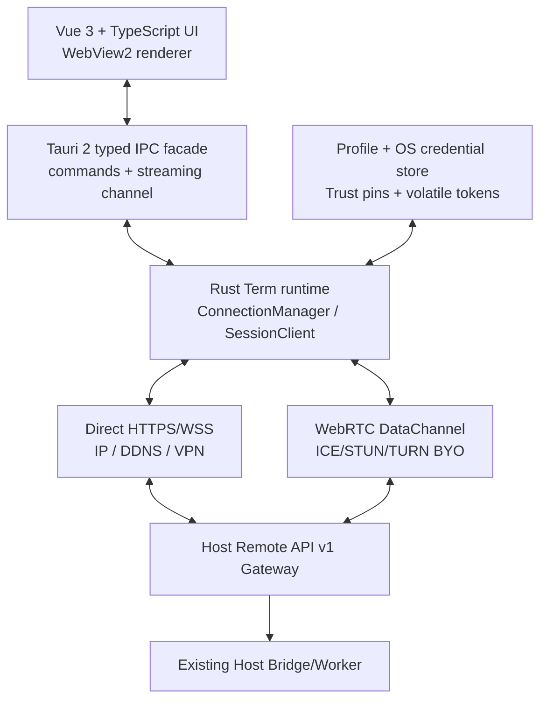
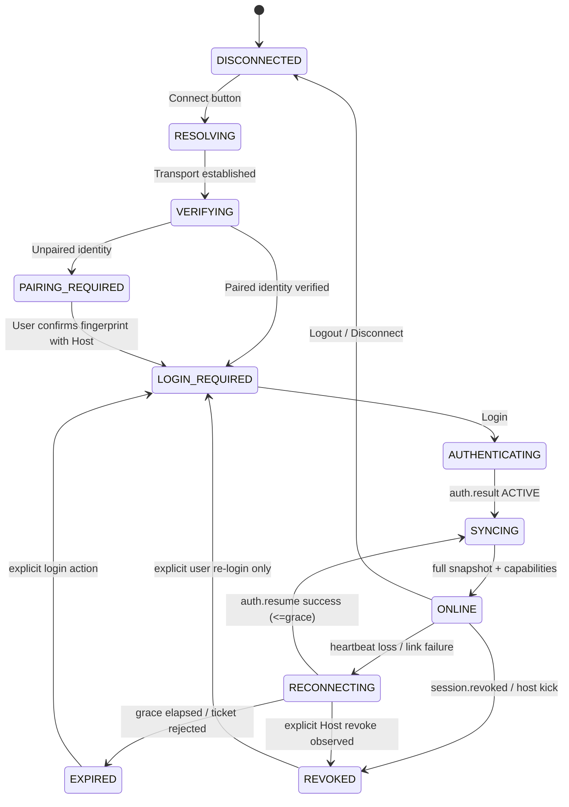

# 24. Tauri Remote Terminal — application architecture

**Status:** PROPOSED FOR REVIEW — architecture v0.17, 2026-10-15.  
**Inherited and unchanged:** approved API v1 (ADR-001–038, conditional ADR-033) and Host Server proposal HOST-P01–P09 (not yet approved).  
**This document authorizes neither implementation nor audit.** Audit methodology will be provided by the project owner after the complete documentation package is assembled.

## 1. Purpose and non-goals

ShockingVRC-Term is a standalone **Windows-first native desktop remote control client** for an existing ShockingVRC Host. It is **not** a second controller/engine: it does not discover DG-LAB devices, open BLE, run OSC/OSCQuery, start stimulation, implement DSP/modulation algorithms or schedule alarms locally. Only the Host has those capabilities. The Term is a remote view and input surface around the accepted API v1.

Minimum product: connect to a manually entered IP/DDNS/VPN name, verify Host identity, authenticate, display all nine existing `egui` sections and provide all 37 remote-exposed operations, live status and catalog/log reading. One local running Term window owns at most one Remote Session to one Host at a time. Remote Host allows only one operator globally regardless of transport.

Non-goals for this milestone: local `egui` replacement, any BLE/OSC/DSP/Alarm changes, mobile application, web browser client, public SaaS, cloud account, hard-coded OpenShock/Moscow infrastructure, new device-protection logic, modifications to existing hardware limits or Worker timing. The owner will separately define the approach to a later **non-destructive, friends-only audit**; this proposal does not preempt that instruction.

## 2. Why Tauri 2 (and what it is not)

Tauri 2 packages an embedded HTML/CSS/TypeScript frontend into a native application; on Windows its renderer is **Microsoft Edge WebView2**. The Rust backend provides OS/native functions, async networking, TLS verification, session handling, and IPC. Vue 3 is the chosen frontend, not a hard requirement of Tauri itself. It is **not Electron**, does not ship a full app-private Chromium by default, and does not imply the application requires an external web server at runtime.

Advantages here: separation of GUI from Rust engine, reusable Vue forms/composables, straightforward charts/visual polish, possible later reuse for local Tauri Host shell, modern UI test tooling. Trade-offs: WebView2/Chromium renderer consumes resources and has version/runtime dependency; JS/Rust IPC and two-language builds add complexity; there is no guarantee Tauri uses less CPU/GPU/RAM than correctly throttled `egui`. `egui` FPS optimization is a separate accepted milestone. Do not promise a measured performance win without measurements.

Official references (consulted 2026-10-15): https://v2.tauri.app/start/ ; https://v2.tauri.app/reference/webview-versions/ ; https://v2.tauri.app/develop/calling-rust/ ; https://v2.tauri.app/develop/calling-frontend/ ; https://v2.tauri.app/start/prerequisites/ .

## 3. Process and trust boundaries



**Only the Rust runtime touches network session credentials** (`access_token`, `resume_ticket`) and validates the Host key. Vue sees connection status, capability data, actual host state, catalogs, logs and structured errors. The password temporarily passes from the form into a Tauri command and is discarded by the frontend after submission; it is not stored in Vue persistence or browser localStorage.

Transport adapters are interchangeable: both deliver the **same v1 JSON message contract** and share the same SessionClient. No separate REST-only state store or WebRTC-specific command grammar.

## 4. Proposed repository layout (Term is isolated)

```
ShockingVRC-Term/
  src-core/ src-app/ src-cli/ src-gui/ src-remote/   # existing/planned host workspace
  src-terminal/                                    # NEW frontend + Tauri package
    package.json
    vite.config.ts
    tsconfig.json
    index.html
    src/
      main.ts
      App.vue
      router/
      components/{layout,controls,charts,connection,common}/
      views/{Connect,Status,Zones,Channels,Tuning,Modulation,Presets,Alarm,Setup,Logs}/
      stores/{connection,hostState,capabilities,catalogs,logs,profileUi}/
      composables/{useChannel,useCommand,useSnapshot,useCapabilities}/
      protocol/{generated,types,validators,operations}/
      assets/
      tests/{unit,components,fixtures}/
    src-tauri/
      Cargo.toml
      tauri.conf.json
      capabilities/default.json
      src/
        lib.rs
        main.rs
        commands.rs               # small IPC allowlist
        app_state.rs
        connection/{manager,state_machine,backoff,heartbeat}.rs
        transport/{mod,direct_wss,rtc}.rs
        session/{auth,resume,replay,identity}.rs
        protocol/{frames,typed_models,errors}.rs
        storage/{profiles,credentials,pins}.rs
        ipc/{subscriptions,events}.rs
      tests/
```

The names above are a **proposal**, not created paths or claims about current source. At build time `src-terminal/src/protocol/generated/` must be generated or checked for agreement against the existing `schemas/remote-*v1*.json`, not handwritten independent interpretations. Rust DTO and TS DTO must be verified by contract tests (generator choice can be selected during implementation).

`src-terminal` should remain a separate Rust/Tauri crate/package. It does **not** link `shocking_vrc_core`, `shocking_vrc_app`, DG-LAB hardware bindings, or `src-gui`; sharing DTO/schema code is acceptable as a strict lightweight dependency without dragging in the engine.

## 5. Core modules

| Module | Responsibility | Explicitly does not do |
|---|---|---|
| `ConnectionManager` | Current profile, connect/disconnect, serialized state machine, transport fallback and retry schedule | Manipulate outputs directly |
| `DirectWssTransport` | TLS-pinned WSS, text JSON request/response, liveness and close | Ignore pin verification |
| `RtcTransport` | ICE/DTLS, ordered reliable DataChannel, BYO signaling/STUN/TURN | Treat signaling as trusted peer identity |
| `SessionClient` | hello/login, token refresh, resume-ticket rotation, logout/revoke, request IDs/dedup | Acquire a second slot |
| `HostIdentityVerifier` | Validate paired Host key, TLS SPKI or signed RTC fingerprint proof, pairing feedback | Approve unknown keys silently |
| `ApiClient` | 37 typed operations, snapshot/capabilities/catalogs/logs, error normalization | Declare `command.accepted` as applied |
| `SnapshotStream` | Initial full snapshot, event sequence, coalescing, gap-triggered full resync | Poll 50-ms engine |
| `ProfileStore` | Save hostname/IP, port, label, preferred transport and pins | Store live session tickets |
| `CredentialStore` | Optional OS-protected saved username/password | Store plaintext credentials in config |
| `UiFacade` | Allowlisted Tauri commands + one-way snapshot streaming to Vue | Expose generic Rust shell/file/network command APIs |
| `Vue app` | All user-facing views, editing and visualization | Hold auth session or decide server power policy |

No tray daemon, autostart, silent background Host control or updater is mandatory for Remote Terminal v1. They are optional future UI features, not hidden requirements.

## 6. Session state machine and lifetime



Approved timing: app-level ping every 5 s, detect no response at approximately 15 s, Host holds session 30 s **after detection**, then frees it. Term retries resume within that grace, not a new login. The same `resume_ticket` lives only in Rust memory; after successful resume rotate it, fence the old transport and request a new full snapshot. Lost ACK replay uses the approved identical request_id, 15-s window and 1/2/4-s retries. Access token lasts 900 s and is refreshed via currently authenticated transport. Command ACK cache 120 s is Host-side. On uncertain command delivery **never blindly replay as new ID**.

Host user can kick/revoke; a revoked Terminal must stop reconnect/login automatically, clear volatile secrets and show a deliberate `Reconnect` action. Login saved in OS credentials can prefill/retry only after explicit new user action following revoke. Host restart makes old session invalid; trust pin may remain if the identity remains unchanged.

Window behavior **proposed**: minimize/defocus keeps connection alive and maintains heartbeat; UI rendering/coalescing may throttle. Explicit Logout and application exit close session; renderer reload reattaches UI to existing Rust connection without creating a new Host session. Unexpected process crash relies on Host heartbeat/grace. `Close` vs system tray not decided: v1 defaults to actual quit, no hidden long-running process.

## 7. Direct connection and self-hosted ICE/TURN

Profile stores `host` as IPv4/IPv6/domain/DDNS and `port` (approved default direct TCP 4318). Resolving DDNS is part of ordinary system DNS, not an application DDNS provider service. Host mapping UPnP/NAT-PMP/PCP is configured on Host, not Terminal. Show human-readable failure categories: DNS failure / timeout / port closed / TLS identity mismatch / wrong login / session busy / remote disabled.

ICE support is required in the overall project and scheduled for M4. Term must support a user-provided signaling URL, list of STUN servers and TURN URL(s)/credentials via profiles; defaults are empty; never ship our Moscow/OpenShock service endpoint or secrets. RTC uses `ordered:true,reliable:true` data transfer and same typed JSON frames. A signaling server can be self-hosted and must not be considered cryptographic authority. The verified Host identity must bind to the negotiated DTLS fingerprint as in conditional ADR-033. If crypto feasibility investigation demands changing wire/security design, return to owner; do not silently choose insecure trust-everything or invent a new API.

Select direct vs RTC **per profile / explicit action** in v1: `Direct` and `ICE / TURN`. Automatic fallback, if later wanted, must not silently redirect credentials to an unpaired Host or to a default third-party infrastructure. Keep exact current Host identity throughout retry/route changes.

## 8. State ownership and correct API feedback

Host `Bridge/Worker` remains authoritative. Local egui and Tauri see changes through snapshots. `bridge_revision` is a ~50-ms publication counter, not config mutation sequence, commit version or completion receipt. `command.accepted queued:true` means enqueue only, not applied/hardware acknowledged; `snapshot` displays actual current state. Remote UI may show a pending control state while awaiting ACK, but it must reconcile immediately to Host truth, including when a local user changes the same control.

Indexed zone/preset operations use current Host list ordering; warn/refresh upon stale selection. Shared Host `active_device` is global: a switch from local egui or Tauri changes selected device for both. Full reconciliation on reconnect, sequence gap, server_epoch change or invalidated catalog cursor. Keep remote policy A/B read-only in Term; do not clip visual actual values even when they exceed an enabled Host cap.

## 9. Change budget and test boundaries

No Core/OSC/BLE/Alarm/DSP edits to implement Terminal. Do not silently modify Host API v1. Use fixtures and mocked `ApiClient` for most UI and protocol tests; use Windows integrated Host tests for wire/IPC; use physical paired systems only for owner-selected final experiments. No destructive or invasive test methods are mandated. No public-service assumptions or enterprise audit checklists should be grafted onto this personal project.

## 10. Dependencies and implementation notes

- Rust stable/MSVC, Tauri 2, Vue 3, TypeScript, Vite. Node.js dev dependency only: deployed Windows terminal is a native installer/executable with packaged frontend; there is no Node server to keep running.
- WebView2 runtime is installed on Windows 11; Tauri installer can ensure runtime on other supported Windows. Do not embed a fixed ~180MB WebView2 by default.
- Rust client libraries: HTTP/WSS over rustls with **actual verifier support**, TLS certificate pin; WebRTC library choice deferred to proof-of-feasibility. Avoid committing to a specific library API without a compilable spike.
- Frontend-to-Rust: typed `invoke` for one-shot actions; Tauri channel (recommended for frequent snapshots) or precisely measured event bridge. No direct WebSocket from Vue so tickets/access tokens cannot leak into WebView.
- The chosen Tauri security/permissions model is a native IPC capability boundary, not extra hardware safety logic. Only expose app-required commands.
