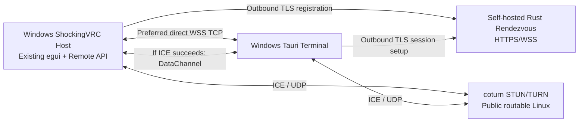

# 29. Self-hosted connectivity: reference architecture (v1.0)

**Status:** DESIGN FOR REVIEW. User-approved constraints: independent self-hosted rendezvous **written in Rust**, coturn, Windows-only Host/Terminal for initial release; every endpoint is **blank by default**. No software deployed. This file adds deployment architecture but cannot override approved API v1 (`14`–`19`).

## Component topology

1. Host and Terminal are **Windows** applications. Rendezvous and coturn are self-hosted **Linux services**; Windows-only restriction does **not** prohibit a Linux server.
2. Direct HTTPS/WSS works with no rendezvous, STUN, TURN or DDNS provider. Optional manual DDNS hostname is simply an address; a built-in DDNS updater is a later feature.
3. Rendezvous relays **signaling** (presence, SDP, ICE candidates and short-lived rendezvous authentication), not ShockingVRC commands or BLE/OSC state.
4. coturn relays encrypted WebRTC packets when ICE cannot form a direct candidate pair; coturn is not the business/application API and does not receive Host login passwords.
5. Host owns session/login/policy; neither rendezvous nor TURN creates a second Remote Session. One active Terminal per Host across all transports.
6. Configured rendezvous is not proof of Host identity. Terminal validates the pairing key/binding per conditional ADR-033 before sending Host credentials.

## Independent components and operational ownership

| Component | Installation | Storage | Network role | Failure impact |
|---|---|---|---|---|
| Host egui + `src-remote` | Nightmare's PC / other user | Host-only policy, credentials, identity | Direct WSS server; outbound signaling if enabled | Local engine survives networking loss |
| Tauri Terminal | Windows client | Profiles, opt-in password storage, pinned identity | Direct WSS or ICE/RTC | Does not run a local Engine |
| Rendezvous binary (`src-rendezvous`) | Any user-supplied Linux server | Minimal named hosts and per-instance auth config; ephemeral session data | HTTPS/WSS accessible from both peers | Direct still works; established RTC may survive independent of signaling |
| coturn | User-supplied Linux server | Secret/server config, optional log | STUN + TURN allocations | Relay may fail; Direct/possible ICE P2P remain |
| Reverse proxy (optional) | Existing operator infrastructure | TLS cert (if terminated here) | TLS for rendezvous domain | It is not Host TLS and must not be mistaken for Host identity |

## Our private Moscow co-location plan

A permissible private deployment is an isolated Rust rendezvous process and isolated coturn on the **Moscow server running OpenShock**. This is NOT a distribution default, public operator service, or a claim that the server has enough capacity. Before installation, inspect the server's **actual OS, ports, public address, current proxy, resource headroom and OpenShock listeners**. Use distinct service names, config and secrets; never replace an existing OpenShock container, firewall rule, reverse-proxy route or port. Port examples below are **proposal values**, not a live inventory.

## Recommended single-instance layout

- Rendezvous: `https://signal.example.net/` over `443/tcp` (or another TLS port) with `/api/signal/v1` WebSocket endpoint; self-hosting without public DNS is possible if clients explicitly trust that TLS endpoint. Do not hard-code this sample domain.
- coturn: `3478/udp` for STUN/TURN; optional `3478/tcp`; optional `5349/tcp` or TLS listener, depending on chosen cert/proxy; allocated relay range **50000–50100/udp** as example, sized for testing. Exact range is operator configurable.
- TURN endpoints are user-selected, may differ from rendezvous host, and are not automatically inferred from the `https://` signaling URL.
- NAT case: an internal coturn behind a router may need external/public IP and UDP forwarding of both listener and allocation relay range. On public VPS prefer direct public networking with explicit allowlist of ports.
- Server process listens only after valid config; no missing-secret `anonymous TURN` defaults and no deployment task run automatically by the Windows client.

## Host/Terminal flow (self-host)

1. User locally enables Remote Access and enters a **non-empty custom** signaling URL if traversals are desired.
2. Host registers public identity ID and transient routing address with rendezvous, using operator-created registration authorization.
3. Terminal selects Host profile, validates explicit identity match and requests a rendezvous exchange.
4. Rendezvous routes signaling to registered Host; exchange expires independently of Host login session.
5. ICE checks local, server-reflexive and relay candidates as available; TURN requires short-lived credentials.
6. DataChannel ready → approved Remote API `hello` and authentication; Host still permits only one remote operator.
7. On disconnect: approved 5/15/30 s session state machine; no device-action side effects.

## Deployment acceptance (documentation-level, not executed)

- Fresh install with empty URLs: no external contact and normal local `egui`; direct WSS can be separately configured.
- Distinct users can self-host separate rendezvous/coturn instances with no dependence on our Moscow server.
- No OpenShock config dependency or request routing into OpenShock.
- Traffic isolation: unauthorized room participants cannot modify Host, regardless of what signaling forwards.
- CGNAT test passes via actual TURN relay only if verified TURN is reachable and endpoints prove identity.
- Clean shutdown releases rendezvous registration, and TURN allocations expire without manual cleanup.

See `30-rendezvous-service-contract.md`, `31-coturn-reference-deployment.md`, `32-connectivity-policy-and-diagnostics.md`, examples in `../deployment/`, and `38-integration-test-matrix.md`.
