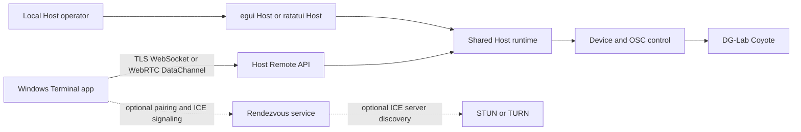

# Architecture overview

ShockingVRC has a local Host and an optional remote Terminal client. The Host owns device access and application state. Terminal displays Host state and sends operations through the Host's authenticated Remote API.

## Components

| Component | Responsibility |
| --- | --- |
| `src-core` | Device discovery, BLE and OSC integration, and control logic |
| `src-app` | Shared runtime orchestration, state, configuration, and logging |
| `src-gui` | Desktop Host interface built with egui |
| `src-cli` | Terminal Host interface built with ratatui |
| `src-remote` | Host-side Remote API, pairing/session authorization, command validation, and access settings |
| `src-rendezvous` | Pairing data and the optional signaling service protocol and server |
| `src-rtc` | WebRTC signaling client, ICE, and data-channel transport |
| `src-diagnostics` | Bounded, redacted diagnostic collection and export |
| `src-terminal` | Separate Tauri 2 and Vue client with Rust-owned connection, credential, and persistence logic |

## Connection flow

Pairing binds a Terminal device identity to a Host identity. The Host authenticates each session and checks operation names, arguments, request identity, rate, and replay state before queueing a command. The Host remains authoritative for state and operation results.

Direct secure WebSocket and WebRTC DataChannel connections carry the same Remote API. Rendezvous is an optional signaling and pairing route; it does not replace Host authorization. TURN is an optional relay for ICE traffic. The Host does not listen for remote sessions unless remote access is explicitly enabled.

## Configuration and stored credentials

On Windows, Host remote settings live in `%APPDATA%\ShockingVRC\remote_access.json`. The listener and traversal settings default to disabled. The Host identity and rendezvous registration key are stored separately as DPAPI-protected files. Terminal profiles keep public connection data; Terminal device credentials and grants use Windows Credential Manager.

## Safety boundary

The Host's remote Power Limits policy validates remote edits to the channel minimum and maximum Power Limits. It does not constrain every operation or guarantee a bound on physical output. Alarm behavior, presets, zones, intensity settings, device behavior, and local controls remain distinct paths. Tests of the API or transport do not prove GUI behavior, Internet connectivity, TURN endurance, or physical-device safety.
