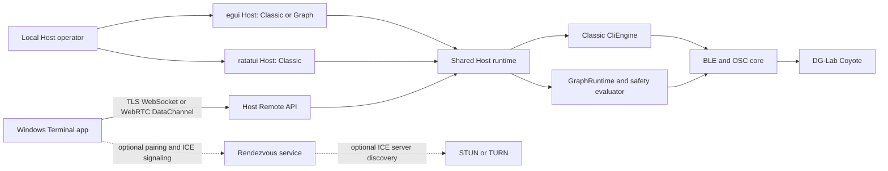

# Architecture overview

This integration combines the official ShockingVRC Host with the private Host/Terminal implementation. The Host owns device access, runtime state, and all output decisions. The Terminal is a separate remote-only client that communicates with the Host's authenticated Remote API.

## Components

| Component | Responsibility |
| --- | --- |
| `src-core` | BLE discovery and transport, old/new firmware protocol support, OSC, Classic controls, Graph evaluation, and Graph safety logic |
| `src-app` | Shared Host runtime, Classic and Graph ownership, device state, configuration, and logging |
| `src-gui` | egui Host with Classic controls, Graph editor, remote settings, and Host state views |
| `src-cli` | ratatui Host with Classic controls and setup preferences |
| `src-remote` | Host-side Remote API v1, pairing/session authorization, command validation, and access settings |
| `src-rendezvous` | Optional pairing and signaling service |
| `src-rtc` | WebRTC signaling client, ICE, and data-channel transport |
| `src-diagnostics` | Bounded, redacted diagnostic collection and export support |
| `src-terminal` | Tauri 2/Vue client with Rust-owned connection, credential, and persistence logic |
| `graph-presets/` | Bundled official Graph presets |

## Host runtime and output ownership

Classic mode uses the existing `CliEngine` and configuration paths. Graph mode uses the Host-owned `GraphRuntime` and the upstream graph evaluator. The selected mode is reported in Host state; only the active runtime sends device output. Switching modes does not erase the other mode's saved configuration.

Graph output passes through upstream validation and safety processing, including the Graph panic-stop state and alarm overlay. Remote code does not get a Graph editing or raw output command, and it cannot clear or bypass the local Graph panic-stop. The Remote API's 37 approved operations retain their existing meanings. While Graph mode is active, commands that edit or apply Classic configuration are rejected with an explicit unsupported-operation response that identifies Graph mode; independent alarm, preference, and catalog operations retain their defined behavior.

The upstream BLE transport selects the supported protocol for the connected device and validates incoming device data. Source tests cover synthetic transports and protocol fixtures. The application does not automatically flash device firmware.

## Connection flow

Pairing binds a Terminal identity to a Host identity. The Host authenticates each session and checks operation names, arguments, request identity, rate, and replay state before queueing an approved command. Acknowledgement means the command was accepted by the Host queue; the Host remains the authority for reported state. Direct secure WebSocket and WebRTC DataChannel connections carry the same Remote API. Rendezvous is optional signaling and does not replace Host authorization.

The Terminal displays Host state and the active mode. It does not contain a BLE engine and does not execute Graph code locally. Graph editing and Graph output control are not part of the current Remote API contract.

Terminal frequency controls use the Host's piecewise pulse-period mapping: raw protocol values 10–240 map to 100–1 Hz, and edits at 1 Hz select the highest supported raw value (240). Values above 240 remain display-compatible with the Host's 1 Hz clamp.

## Configuration and limits

On Windows, Host remote settings are stored at `%APPDATA%\ShockingVRC\remote_access.json`. The listener and ICE traversal default to disabled, and rendezvous and ICE server addresses default to empty. The Host identity and rendezvous registration key are DPAPI-protected. Terminal device credentials are stored in Windows Credential Manager.

The optional A/B Power Limits ceiling is disabled by default. When enabled, it applies to configured min/max limits for both local and remote edits and reconciles existing values. It is not a physical-output limiter and does not cover every output path. Graph's independent safety rules and panic-stop remain in force; the Power Limits policy does not replace them.

## Build and validation

Host commands and Graph tests are in the root Rust workspace. Terminal frontend commands run from `src-terminal` with Node.js 22; its Rust backend has a separate manifest under `src-terminal/src-tauri`. The root README contains the supported build commands.

GitHub Actions checks formatting, the Host workspace on Linux, Windows, and macOS, and the Terminal frontend/backend on Windows. This branch does not configure automatic release publishing.

Automated tests do not establish physical-device, GUI, WAN/TURN endurance, or electrical-output acceptance.
